<!--
  GDG-TIET organisation profile.
  Lives at profile/README.md. In the private `.github-private` repo only org
  members see it; in a public `.github` repo everyone does. Image paths are
  relative, so it works in either.
  Every card is drawn by scripts/build_svgs.py: edit its CONFIG block, rerun it,
  and commit profile/assets. TODO comments mark slots still waiting for content.
-->

<picture>
  <source media="(prefers-color-scheme: dark)" srcset="assets/hero-dark.svg">
  <source media="(prefers-color-scheme: light)" srcset="assets/hero-light.svg">
  
</picture>

  

<!-- TODO: website and email badges once they exist -->

 

<picture>
  <source media="(prefers-color-scheme: dark)" srcset="assets/header-about-dark.svg">
  <source media="(prefers-color-scheme: light)" srcset="assets/header-about-light.svg">
  
</picture>

<picture>
  <source media="(prefers-color-scheme: dark)" srcset="assets/about-dark.svg">
  <source media="(prefers-color-scheme: light)" srcset="assets/about-light.svg">
  
</picture>

  

<picture>
  <source media="(prefers-color-scheme: dark)" srcset="assets/header-domains-dark.svg">
  <source media="(prefers-color-scheme: light)" srcset="assets/header-domains-light.svg">
  
</picture>

<picture>
  <source media="(prefers-color-scheme: dark)" srcset="assets/domains-dark.svg">
  <source media="(prefers-color-scheme: light)" srcset="assets/domains-light.svg">
  
</picture>

  

<picture>
  <source media="(prefers-color-scheme: dark)" srcset="assets/header-events-dark.svg">
  <source media="(prefers-color-scheme: light)" srcset="assets/header-events-light.svg">
  
</picture>

<picture>
  <source media="(prefers-color-scheme: dark)" srcset="assets/events-dark.svg">
  <source media="(prefers-color-scheme: light)" srcset="assets/events-light.svg">
  
</picture>

Recaps of every one of these live in the <a href="https://www.instagram.com/gdg.tiet/">@gdg.tiet</a> highlights.

 

<picture>
  <source media="(prefers-color-scheme: dark)" srcset="assets/header-projects-dark.svg">
  <source media="(prefers-color-scheme: light)" srcset="assets/header-projects-light.svg">
  
</picture>

<!-- The card lists the org's public repos each time scripts/build_svgs.py runs. -->
<picture>
  <source media="(prefers-color-scheme: dark)" srcset="assets/projects-dark.svg">
  <source media="(prefers-color-scheme: light)" srcset="assets/projects-light.svg">
  
</picture>

  

<picture>
  <source media="(prefers-color-scheme: dark)" srcset="assets/header-core-team-dark.svg">
  <source media="(prefers-color-scheme: light)" srcset="assets/header-core-team-light.svg">
  
</picture>

<!-- TODO: fill TEAM in scripts/build_svgs.py (name, role, github) and rerun; avatars are fetched and embedded -->
<picture>
  <source media="(prefers-color-scheme: dark)" srcset="assets/team-dark.svg">
  <source media="(prefers-color-scheme: light)" srcset="assets/team-light.svg">
  
</picture>

  

<picture>
  <source media="(prefers-color-scheme: dark)" srcset="assets/header-connect-dark.svg">
  <source media="(prefers-color-scheme: light)" srcset="assets/header-connect-light.svg">
  
</picture>

<a href="https://www.instagram.com/gdg.tiet/"><picture>
  <source media="(prefers-color-scheme: dark)" srcset="assets/connect-instagram-dark.svg">
  <source media="(prefers-color-scheme: light)" srcset="assets/connect-instagram-light.svg">
  
</picture></a>
<a href="https://www.linkedin.com/company/developer-student-club-thapar/"><picture>
  <source media="(prefers-color-scheme: dark)" srcset="assets/connect-linkedin-dark.svg">
  <source media="(prefers-color-scheme: light)" srcset="assets/connect-linkedin-light.svg">
  
</picture></a>

 

<picture>
  <source media="(prefers-color-scheme: dark)" srcset="assets/footer-dark.svg">
  <source media="(prefers-color-scheme: light)" srcset="assets/footer-light.svg">
  
</picture>
