<!--
  GDG-TIET organisation profile.
  Lives at profile/README.md in the org's public `.github` repo, which is what
  github.com/GDG-TIET shows to everyone.
  Every card is drawn by scripts/build_svgs.py: edit its CONFIG block, rerun it,
  and commit profile/assets. TODO comments mark slots still waiting for content.
-->

<picture>
  <source media="(prefers-color-scheme: dark)" srcset="assets/hero-dark.svg">
  <source media="(prefers-color-scheme: light)" srcset="assets/hero-light.svg">
  
</picture>

  

<!-- TODO: website and email badges once they exist -->

 

<picture>
  <source media="(prefers-color-scheme: dark)" srcset="assets/header-about-dark.svg">
  <source media="(prefers-color-scheme: light)" srcset="assets/header-about-light.svg">
  
</picture>

<picture>
  <source media="(prefers-color-scheme: dark)" srcset="assets/about-dark.svg">
  <source media="(prefers-color-scheme: light)" srcset="assets/about-light.svg">
  
</picture>

  

<picture>
  <source media="(prefers-color-scheme: dark)" srcset="assets/header-domains-dark.svg">
  <source media="(prefers-color-scheme: light)" srcset="assets/header-domains-light.svg">
  
</picture>

<picture>
  <source media="(prefers-color-scheme: dark)" srcset="assets/domains-dark.svg">
  <source media="(prefers-color-scheme: light)" srcset="assets/domains-light.svg">
  
</picture>

  

<picture>
  <source media="(prefers-color-scheme: dark)" srcset="assets/header-events-dark.svg">
  <source media="(prefers-color-scheme: light)" srcset="assets/header-events-light.svg">
  
</picture>

<picture>
  <source media="(prefers-color-scheme: dark)" srcset="assets/events-dark.svg">
  <source media="(prefers-color-scheme: light)" srcset="assets/events-light.svg">
  
</picture>

DevFest '26 ran as a five-day workshop, and the rest of this season is on its way. Photos and recaps live on <a href="https://www.instagram.com/gdg.tiet/">@gdg.tiet</a>.

 

<picture>
  <source media="(prefers-color-scheme: dark)" srcset="assets/header-projects-dark.svg">
  <source media="(prefers-color-scheme: light)" srcset="assets/header-projects-light.svg">
  
</picture>

<!-- The card lists the org's public repos each time scripts/build_svgs.py runs. -->
<picture>
  <source media="(prefers-color-scheme: dark)" srcset="assets/projects-dark.svg">
  <source media="(prefers-color-scheme: light)" srcset="assets/projects-light.svg">
  
</picture>

  

<picture>
  <source media="(prefers-color-scheme: dark)" srcset="assets/header-executive-board-dark.svg">
  <source media="(prefers-color-scheme: light)" srcset="assets/header-executive-board-light.svg">
  
</picture>

<!-- Written by scripts/build_svgs.py from EB in its CONFIG block. -->
<!-- eb:start -->

<a href="https://github.com/yuv44n"><picture><source media="(prefers-color-scheme: dark)" srcset="assets/eb-yuv44n-dark.svg"><source media="(prefers-color-scheme: light)" srcset="assets/eb-yuv44n-light.svg"></picture></a>
<a href="https://github.com/tarushmohindru"><picture><source media="(prefers-color-scheme: dark)" srcset="assets/eb-tarushmohindru-dark.svg"><source media="(prefers-color-scheme: light)" srcset="assets/eb-tarushmohindru-light.svg"></picture></a>
<a href="https://github.com/LavanyaVats"><picture><source media="(prefers-color-scheme: dark)" srcset="assets/eb-lavanyavats-dark.svg"><source media="(prefers-color-scheme: light)" srcset="assets/eb-lavanyavats-light.svg"></picture></a>
<a href="https://github.com/Mani7005"><picture><source media="(prefers-color-scheme: dark)" srcset="assets/eb-mani7005-dark.svg"><source media="(prefers-color-scheme: light)" srcset="assets/eb-mani7005-light.svg"></picture></a>
<a href="https://github.com/Abhi2939"><picture><source media="(prefers-color-scheme: dark)" srcset="assets/eb-abhi2939-dark.svg"><source media="(prefers-color-scheme: light)" srcset="assets/eb-abhi2939-light.svg"></picture></a>
<a href="https://github.com/HarshdeepAthawale"><picture><source media="(prefers-color-scheme: dark)" srcset="assets/eb-harshdeepathawale-dark.svg"><source media="(prefers-color-scheme: light)" srcset="assets/eb-harshdeepathawale-light.svg"></picture></a>
<a href="https://github.com/atpugvaraa"><picture><source media="(prefers-color-scheme: dark)" srcset="assets/eb-atpugvaraa-dark.svg"><source media="(prefers-color-scheme: light)" srcset="assets/eb-atpugvaraa-light.svg"></picture></a>

<!-- eb:end -->

  

<picture>
  <source media="(prefers-color-scheme: dark)" srcset="assets/header-core-team-dark.svg">
  <source media="(prefers-color-scheme: light)" srcset="assets/header-core-team-light.svg">
  
</picture>

<!-- Badges are the org's members. Don't edit the grid by hand: scripts/build_svgs.py rewrites it (run it with GITHUB_TOKEN after people join). ROLES there adds a role line. -->
<!-- team:start -->

<a href="https://github.com/abhinavtop1G"><picture><source media="(prefers-color-scheme: dark)" srcset="assets/badge-abhinavtop1g-dark.svg"><source media="(prefers-color-scheme: light)" srcset="assets/badge-abhinavtop1g-light.svg"></picture></a>
<a href="https://github.com/GhxstOSINT"><picture><source media="(prefers-color-scheme: dark)" srcset="assets/badge-ghxstosint-dark.svg"><source media="(prefers-color-scheme: light)" srcset="assets/badge-ghxstosint-light.svg"></picture></a>
<a href="https://github.com/AndrewPrakash1"><picture><source media="(prefers-color-scheme: dark)" srcset="assets/badge-andrewprakash1-dark.svg"><source media="(prefers-color-scheme: light)" srcset="assets/badge-andrewprakash1-light.svg"></picture></a>
<a href="https://github.com/Aryamann002"><picture><source media="(prefers-color-scheme: dark)" srcset="assets/badge-aryamann002-dark.svg"><source media="(prefers-color-scheme: light)" srcset="assets/badge-aryamann002-light.svg"></picture></a>
<a href="https://github.com/jatin26garg"><picture><source media="(prefers-color-scheme: dark)" srcset="assets/badge-jatin26garg-dark.svg"><source media="(prefers-color-scheme: light)" srcset="assets/badge-jatin26garg-light.svg"></picture></a>
<a href="https://github.com/kavyabansal2611"><picture><source media="(prefers-color-scheme: dark)" srcset="assets/badge-kavyabansal2611-dark.svg"><source media="(prefers-color-scheme: light)" srcset="assets/badge-kavyabansal2611-light.svg"></picture></a>
<a href="https://github.com/KUSHAGR27"><picture><source media="(prefers-color-scheme: dark)" srcset="assets/badge-kushagr27-dark.svg"><source media="(prefers-color-scheme: light)" srcset="assets/badge-kushagr27-light.svg"></picture></a>
<a href="https://github.com/lakshwadhwa98"><picture><source media="(prefers-color-scheme: dark)" srcset="assets/badge-lakshwadhwa98-dark.svg"><source media="(prefers-color-scheme: light)" srcset="assets/badge-lakshwadhwa98-light.svg"></picture></a>
<a href="https://github.com/mannatkhosla"><picture><source media="(prefers-color-scheme: dark)" srcset="assets/badge-mannatkhosla-dark.svg"><source media="(prefers-color-scheme: light)" srcset="assets/badge-mannatkhosla-light.svg"></picture></a>
<a href="https://github.com/ruthvikpeteti"><picture><source media="(prefers-color-scheme: dark)" srcset="assets/badge-ruthvikpeteti-dark.svg"><source media="(prefers-color-scheme: light)" srcset="assets/badge-ruthvikpeteti-light.svg"></picture></a>
<a href="https://github.com/Shreshtha-ai"><picture><source media="(prefers-color-scheme: dark)" srcset="assets/badge-shreshtha-ai-dark.svg"><source media="(prefers-color-scheme: light)" srcset="assets/badge-shreshtha-ai-light.svg"></picture></a>
<a href="https://github.com/utkarsh-goel18"><picture><source media="(prefers-color-scheme: dark)" srcset="assets/badge-utkarsh-goel18-dark.svg"><source media="(prefers-color-scheme: light)" srcset="assets/badge-utkarsh-goel18-light.svg"></picture></a>
<a href="https://github.com/VarunJoshi07"><picture><source media="(prefers-color-scheme: dark)" srcset="assets/badge-varunjoshi07-dark.svg"><source media="(prefers-color-scheme: light)" srcset="assets/badge-varunjoshi07-light.svg"></picture></a>
<a href="https://github.com/vidyanshistryingtocoDe"><picture><source media="(prefers-color-scheme: dark)" srcset="assets/badge-vidyanshistryingtocode-dark.svg"><source media="(prefers-color-scheme: light)" srcset="assets/badge-vidyanshistryingtocode-light.svg"></picture></a>
<a href="https://github.com/yashmangla007"><picture><source media="(prefers-color-scheme: dark)" srcset="assets/badge-yashmangla007-dark.svg"><source media="(prefers-color-scheme: light)" srcset="assets/badge-yashmangla007-light.svg"></picture></a>

<!-- team:end -->

  

<picture>
  <source media="(prefers-color-scheme: dark)" srcset="assets/header-connect-dark.svg">
  <source media="(prefers-color-scheme: light)" srcset="assets/header-connect-light.svg">
  
</picture>

<a href="https://www.instagram.com/gdg.tiet/"><picture>
  <source media="(prefers-color-scheme: dark)" srcset="assets/connect-instagram-dark.svg">
  <source media="(prefers-color-scheme: light)" srcset="assets/connect-instagram-light.svg">
  
</picture></a>
<a href="https://www.linkedin.com/company/developer-student-club-thapar/"><picture>
  <source media="(prefers-color-scheme: dark)" srcset="assets/connect-linkedin-dark.svg">
  <source media="(prefers-color-scheme: light)" srcset="assets/connect-linkedin-light.svg">
  
</picture></a>

 

<picture>
  <source media="(prefers-color-scheme: dark)" srcset="assets/header-leaderboard-dark.svg">
  <source media="(prefers-color-scheme: light)" srcset="assets/header-leaderboard-light.svg">
  
</picture>

<!-- Written by scripts/build_svgs.py from GitHub's numbers: rerun it (with GITHUB_TOKEN) to refresh the board. -->
<!-- leaderboard:start -->

<a href="https://github.com/yashmangla007"><picture><source media="(prefers-color-scheme: dark)" srcset="assets/podium-2-dark.svg"><source media="(prefers-color-scheme: light)" srcset="assets/podium-2-light.svg"></picture></a>
<a href="https://github.com/abhinavtop1G"><picture><source media="(prefers-color-scheme: dark)" srcset="assets/podium-1-dark.svg"><source media="(prefers-color-scheme: light)" srcset="assets/podium-1-light.svg"></picture></a>
<a href="https://github.com/Shreshtha-ai"><picture><source media="(prefers-color-scheme: dark)" srcset="assets/podium-3-dark.svg"><source media="(prefers-color-scheme: light)" srcset="assets/podium-3-light.svg"></picture></a>

<a href="https://github.com/Aryamann002"><picture><source media="(prefers-color-scheme: dark)" srcset="assets/rank-04-dark.svg"><source media="(prefers-color-scheme: light)" srcset="assets/rank-04-light.svg"></picture></a>
<a href="https://github.com/utkarsh-goel18"><picture><source media="(prefers-color-scheme: dark)" srcset="assets/rank-05-dark.svg"><source media="(prefers-color-scheme: light)" srcset="assets/rank-05-light.svg"></picture></a>
<a href="https://github.com/ruthvikpeteti"><picture><source media="(prefers-color-scheme: dark)" srcset="assets/rank-06-dark.svg"><source media="(prefers-color-scheme: light)" srcset="assets/rank-06-light.svg"></picture></a>
<a href="https://github.com/Mani7005"><picture><source media="(prefers-color-scheme: dark)" srcset="assets/rank-07-dark.svg"><source media="(prefers-color-scheme: light)" srcset="assets/rank-07-light.svg"></picture></a>
<a href="https://github.com/GhxstOSINT"><picture><source media="(prefers-color-scheme: dark)" srcset="assets/rank-08-dark.svg"><source media="(prefers-color-scheme: light)" srcset="assets/rank-08-light.svg"></picture></a>
<a href="https://github.com/AndrewPrakash1"><picture><source media="(prefers-color-scheme: dark)" srcset="assets/rank-09-dark.svg"><source media="(prefers-color-scheme: light)" srcset="assets/rank-09-light.svg"></picture></a>
<a href="https://github.com/kavyabansal2611"><picture><source media="(prefers-color-scheme: dark)" srcset="assets/rank-10-dark.svg"><source media="(prefers-color-scheme: light)" srcset="assets/rank-10-light.svg"></picture></a>
<a href="https://github.com/jatin26garg"><picture><source media="(prefers-color-scheme: dark)" srcset="assets/rank-11-dark.svg"><source media="(prefers-color-scheme: light)" srcset="assets/rank-11-light.svg"></picture></a>
<a href="https://github.com/KUSHAGR27"><picture><source media="(prefers-color-scheme: dark)" srcset="assets/rank-12-dark.svg"><source media="(prefers-color-scheme: light)" srcset="assets/rank-12-light.svg"></picture></a>
<a href="https://github.com/vidyanshistryingtocoDe"><picture><source media="(prefers-color-scheme: dark)" srcset="assets/rank-13-dark.svg"><source media="(prefers-color-scheme: light)" srcset="assets/rank-13-light.svg"></picture></a>
<a href="https://github.com/VarunJoshi07"><picture><source media="(prefers-color-scheme: dark)" srcset="assets/rank-14-dark.svg"><source media="(prefers-color-scheme: light)" srcset="assets/rank-14-light.svg"></picture></a>
<a href="https://github.com/lakshwadhwa98"><picture><source media="(prefers-color-scheme: dark)" srcset="assets/rank-15-dark.svg"><source media="(prefers-color-scheme: light)" srcset="assets/rank-15-light.svg"></picture></a>
<a href="https://github.com/mannatkhosla"><picture><source media="(prefers-color-scheme: dark)" srcset="assets/rank-16-dark.svg"><source media="(prefers-color-scheme: light)" srcset="assets/rank-16-light.svg"></picture></a>

GitHub contributions over the last 12 months, as of 4 November 2026. Lit cells are each person's last 26 weeks; the bar compares them with first place.

<!-- leaderboard:end -->

 

<picture>
  <source media="(prefers-color-scheme: dark)" srcset="assets/footer-dark.svg">
  <source media="(prefers-color-scheme: light)" srcset="assets/footer-light.svg">
  
</picture>
